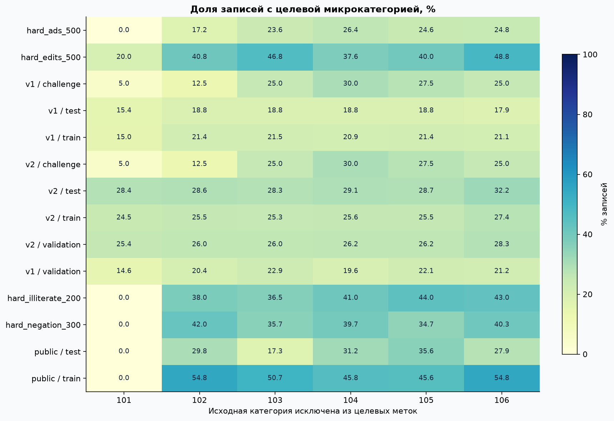
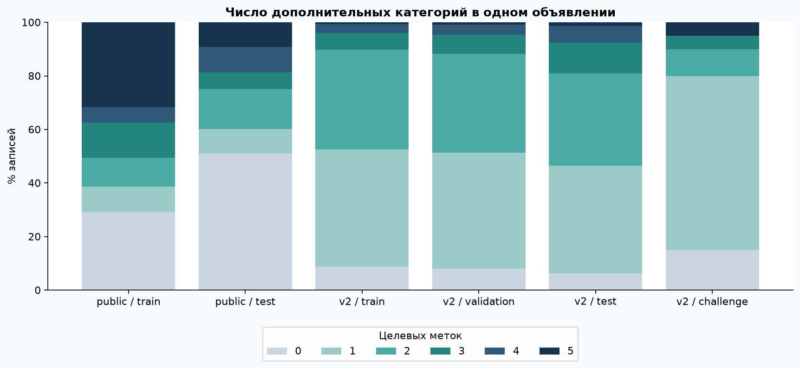
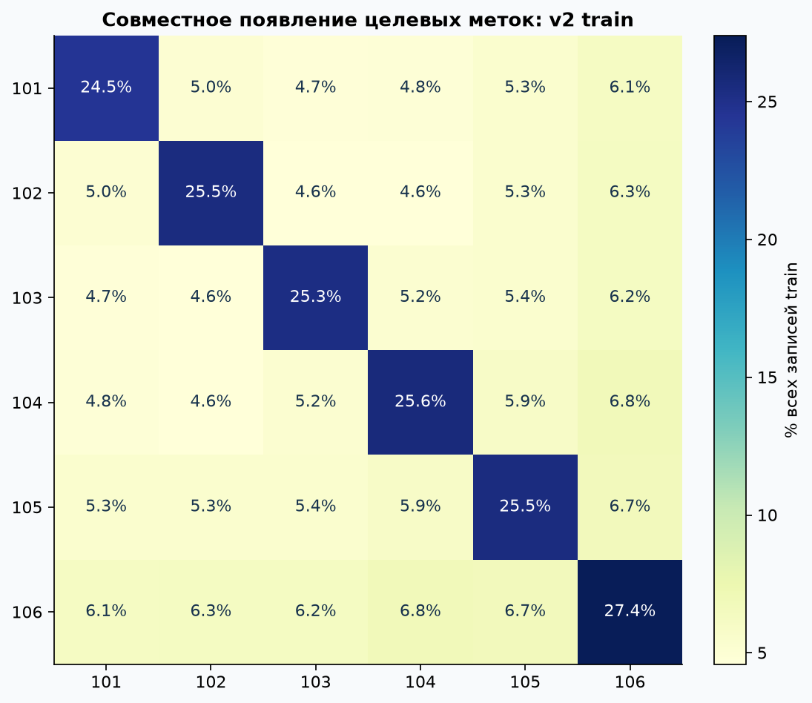
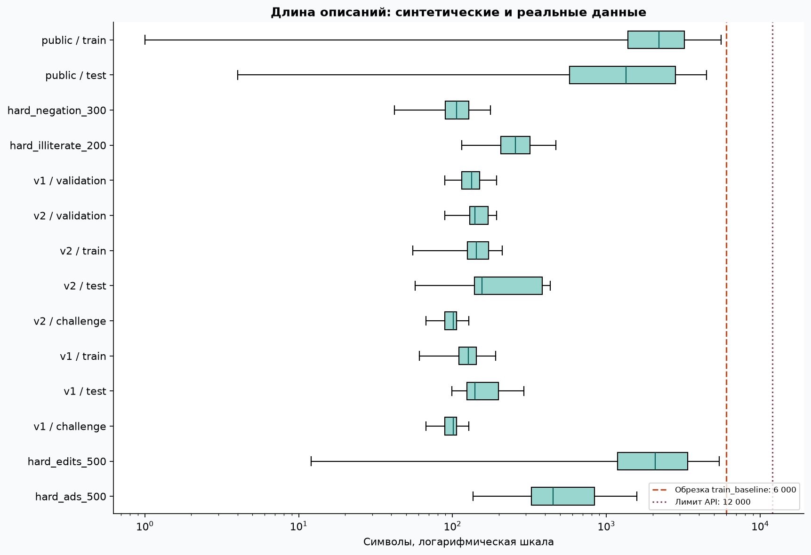
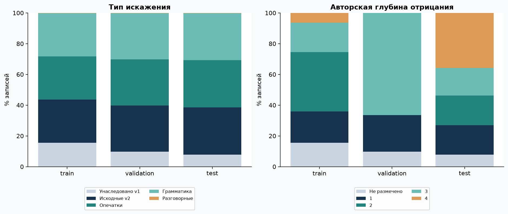
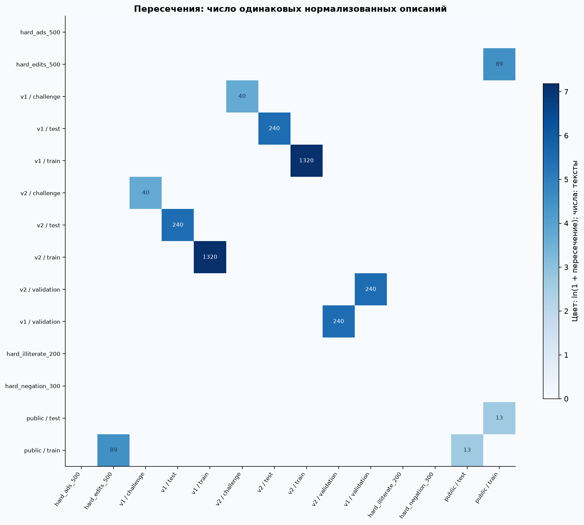

# EDA датасетов Авито

Проверены все 14 файлов: 27,508 строк, 20,341 уникальных нормализованных описаний. Это инвентаризация всех версий, а не единая обучающая выборка. V2 содержит v1 целиком. Содержимое всех 14 файлов при переносе в datasets/ сохранено; SHA-256 зафиксированы в migration_manifest.json и inventory.json.

## Основные выводы

В public train 10,000 строк, но только 4,855 уникальных описаний (51.5% строк — дополнительные повторы). Случайное разделение по строкам создаёт риск утечки и завышения метрик. В public test — 139 уникальных описаний из 208 строк.

Public train и test пересекаются по 13 уникальным описаниям: это затрагивает 168 строк public train и 24 строки public test. Во всех данных найдено 13 групп одинаковых описаний с разными целевыми метками при одинаковом исходном mcId. Все такие случаи доступны построчно в overlaps.json.

V2 train содержит 8,464 строк. Доля пустых ответов — 8.7%. Медиана длины — 143 символов против 2196 в public train. Синтетические конструкции заметно отличаются от реальных объявлений; качество на них нельзя переносить на реальный поток без проверки.

В v2 пересечений нормализованных текстов между выборками нет; пересечений group_id: 0, семейств type: 0. Модель не обучалась: этот отчёт описывает данные, а не точность классификации.

## 1. Состав и качество структуры

| Файл относительно datasets/ | Строк | Уникальных текстов | Повторов сверх первого | Пустых ответов, % |
| --- | --- | --- | --- | --- |
| distillate_dataset/hard_ads_500.jsonl | 500 | 500 | 0 | 28.0 |
| distillate_dataset/hard_edits_500.jsonl | 500 | 489 | 11 | 34.0 |
| hard_dataset/challenge.jsonl | 40 | 40 | 0 | 15.0 |
| hard_dataset/test.jsonl | 240 | 240 | 0 | 2.1 |
| hard_dataset/train.jsonl | 1320 | 1320 | 0 | 12.1 |
| hard_dataset/v2/challenge.jsonl | 40 | 40 | 0 | 15.0 |
| hard_dataset/v2/test.jsonl | 3016 | 3016 | 0 | 6.3 |
| hard_dataset/v2/train.jsonl | 8464 | 8464 | 0 | 8.7 |
| hard_dataset/v2/validation.jsonl | 2440 | 2440 | 0 | 8.0 |
| hard_dataset/validation.jsonl | 240 | 240 | 0 | 8.3 |
| hard_illiterate_200/hard_illiterate_200.jsonl | 200 | 200 | 0 | 24.5 |
| hard_negation_300/hard_negation_300.jsonl | 300 | 300 | 0 | 0.0 |
| public/public-test-dataset.parquet | 208 | 139 | 69 | 51.0 |
| public/public-train-annotated.jsonl | 10000 | 4855 | 5145 | 29.1 |

JSONL читается целиком, категории проверяются по диапазону 101–106. В Parquet поле categories содержит названия категорий, которые сопоставлены mcId. Для публичных файлов источник 101 задан по README организаторов. В остальных файлах используется явный mcId. Заголовок не входит в сравнение текстов: текущий сервис получает description. Различающиеся заголовки могут объяснять часть исходных меток, но не устраняют неоднозначность для такого сервиса.

В public train есть 98 описаний короче 20 символов, в том числе одиночные буквы и числовые заглушки. Эти строки стоит отдельно проверить на информативность; краткость сама по себе не доказывает ошибку метки. Они сохранены в данных и учтены во всех расчётах.

| Выборка v2 | Строк | Смысловых групп | Вариантов смысла (группа × 2) |
| --- | --- | --- | --- |
| challenge | 40 | 20 | 40 |
| test | 3016 | 584 | 1168 |
| train | 8464 | 1856 | 3712 |
| validation | 2440 | 488 | 976 |

Смысловая группа объединяет контрастную пару и её искажённые версии. Эти строки полезны для обучения устойчивости, но не являются независимыми новыми сюжетами.

## 2. Микрокатегории и число меток

| ID | Микрокатегория | Предлагается: v2 train | Целевая: v2 train | Исключено как источник |
| --- | --- | --- | --- | --- |
| 101 | Ремонт под ключ | 2515 | 2071 | 444 |
| 102 | Штукатурные работы | 2516 | 2156 | 360 |
| 103 | Плиточные работы | 2517 | 2141 | 376 |
| 104 | Сантехника | 2516 | 2168 | 348 |
| 105 | Электрика | 2517 | 2156 | 361 |
| 106 | Поклейка обоев и малярные работы | 2520 | 2318 | 202 |

Отношение максимальной частоты целевой метки к минимальной в v2 train: 1.12. Нулевую частоту 101 в public нельзя считать отсутствием комплексного ремонта: 101 там является исходной категорией и исключается из ответа. Для модели только по тексту обучающая цель — offered_microcategories; удалять исходный mcId нужно после предсказания. Текущий сервис и train_baseline поддерживают только 102–106, поэтому для полной задачи потребуется голова 101.

| Категория | Public train: по строкам, % | По уникальным текстам, % |
| --- | --- | --- |
| 101 | 0.0 | 0.0 |
| 102 | 54.8 | 51.3 |
| 103 | 50.7 | 48.6 |
| 104 | 45.8 | 47.8 |
| 105 | 45.6 | 47.4 |
| 106 | 54.8 | 54.7 |

Максимальная группа одинаковых описаний в public train содержит 94 строк. Таблица показывает, как повторы меняют вес категорий; внутри public train совпавшие описания не имеют конфликтующих меток, поэтому здесь допустимо сравнение с одним экземпляром текста.

## 3. Длины текстов и ограничения входа

| Набор | Символов p50 | p95 | max | Слов p50 | >6000 | >12000 |
| --- | --- | --- | --- | --- | --- | --- |
| hard_ads_500 | 449.5 | 1558.1 | 1934.0 | 61.0 | 0 | 0 |
| hard_edits_500 | 2077.0 | 4953.0 | 5434.0 | 263.5 | 0 | 0 |
| v1 / challenge | 101.0 | 123.2 | 151.0 | 14.0 | 0 | 0 |
| v1 / test | 140.0 | 269.0 | 290.0 | 20.0 | 0 | 0 |
| v1 / train | 127.0 | 166.0 | 203.0 | 18.0 | 0 | 0 |
| v2 / challenge | 101.0 | 123.2 | 151.0 | 14.0 | 0 | 0 |
| v2 / test | 155.0 | 415.0 | 433.0 | 21.0 | 0 | 0 |
| v2 / train | 143.0 | 409.0 | 530.0 | 19.0 | 0 | 0 |
| v2 / validation | 140.0 | 528.0 | 631.0 | 19.0 | 0 | 0 |
| v1 / validation | 133.5 | 172.1 | 193.0 | 19.0 | 0 | 0 |
| hard_illiterate_200 | 256.0 | 397.1 | 469.0 | 38.0 | 0 | 0 |
| hard_negation_300 | 106.0 | 163.0 | 199.0 | 16.0 | 0 | 0 |
| public / test | 1343.0 | 3875.5 | 4480.0 | 175.0 | 0 | 0 |
| public / train | 2196.0 | 4960.0 | 5564.0 | 285.0 | 0 | 0 |

Все просмотренные описания короче 6 000 символов: текущий срез в avito_compare/scripts/train_baseline.py не обрезает эти данные. API принимает до 12 000 символов. Слово здесь — последовательность латинских или кириллических букв, а не токен языковой модели.

## 4. Отрицания, ограничения и искажения

| Набор | НЕ/НИ/НЕТ, % строк | ≥2 таких слов, % | ТОЛЬКО/ЛИШЬ, % | Смешанная кириллица/латиница, % |
| --- | --- | --- | --- | --- |
| hard_ads_500 | 47.8 | 34.2 | 16.2 | 0.0 |
| hard_edits_500 | 67.6 | 45.6 | 26.4 | 24.6 |
| v1 / challenge | 87.5 | 37.5 | 47.5 | 0.0 |
| v1 / test | 100.0 | 62.5 | 25.0 | 0.0 |
| v1 / train | 75.0 | 20.5 | 25.0 | 0.0 |
| v2 / challenge | 87.5 | 37.5 | 47.5 | 0.0 |
| v2 / test | 99.7 | 69.8 | 2.0 | 0.0 |
| v2 / train | 95.8 | 45.1 | 10.3 | 0.0 |
| v2 / validation | 86.1 | 44.4 | 2.5 | 0.0 |
| v1 / validation | 75.0 | 12.5 | 25.0 | 0.0 |
| hard_illiterate_200 | 54.5 | 20.5 | 3.5 | 0.0 |
| hard_negation_300 | 87.0 | 21.7 | 13.7 | 0.0 |
| public / test | 45.7 | 32.7 | 20.2 | 6.2 |
| public / train | 66.5 | 43.0 | 27.2 | 5.4 |

Число НЕ/НИ/НЕТ — лексическая характеристика, не смысловая глубина. Слитное «неделаю» и ошибочное «ниправда» этим счётчиком не учитываются. Вложенность размечена авторами синтетических сценариев. Смешение алфавитов — индикатор возможной обфускации; оно также встречается в артикулах и названиях и не является доказательством ошибки. Автоматического надёжного подсчёта всех грамматических ошибок в реальных объявлениях здесь нет.

## 5. Дубликаты, разбиение и происхождение

| Файл A | Файл B | Общих уникальных текстов | Строк A | Строк B |
| --- | --- | --- | --- | --- |
| distillate_dataset/hard_edits_500.jsonl | public/public-train-annotated.jsonl | 89 | 100 | 1036 |
| hard_dataset/challenge.jsonl | hard_dataset/v2/challenge.jsonl | 40 | 40 | 40 |
| hard_dataset/test.jsonl | hard_dataset/v2/test.jsonl | 240 | 240 | 240 |
| hard_dataset/train.jsonl | hard_dataset/v2/train.jsonl | 1320 | 1320 | 1320 |
| hard_dataset/v2/validation.jsonl | hard_dataset/validation.jsonl | 240 | 240 | 240 |
| public/public-test-dataset.parquet | public/public-train-annotated.jsonl | 13 | 24 | 168 |

Все 500 контролируемых правок hard_edits имеют source_item_id; они происходят от 500 исходных объявлений. Их необходимо группировать с исходниками при разделении даже при различающихся текстах. Семейства v2 разделены между train/validation/test, но используют общую лексику и сходные логические операции: отсутствие совпавших строк не доказывает полную семантическую независимость.

Актуальный аудит отмечает 248 уникальных строк старых наборов для дополнительной проверки: medium-confidence, предположение о категории 101 и неоднозначные операции. Это кандидаты на проверку, не доказанные ошибки. Четыре подтверждённые ошибки ранее исправлены с сохранением старых меток в legacy_corrections.json. Исходный публичный тест не переразмечен автоматически.

## 6. Рекомендации для обучения и оценки

Использовать готовые train/validation/test v2 и не добавлять к ним v1. При присоединении реальных данных сначала убрать повторы и разделить исходники вместе с их производными по source_item_id. Одинаковые тексты с разными метками отправлять на проверку, не выбирать метку большинством автоматически.

Публичный тест оставить вне обучения. Из-за пересечений и конфликтов дополнительно подготовить независимую проверенную выборку реальных объявлений; отдельно показывать метрики на конфликтных и неконфликтных подмножествах, не выдавая очищенную метрику за официальную.

Долю синтетики подбирать на реальной валидации. Сравнить реальные данные, реальные плюс синтетика и реальные плюс синтетика с ошибками при одинаковой оценочной выборке. Не выбирать коэффициент смешивания по синтетическому test.

Измерять micro-F1, F1 по каждой из шести категорий, точное совпадение набора, ложные положительные на пустых ответах, долю полностью правильных контрастных пар и изменение ответа после внесения ошибок. Отдельно показывать глубины отрицания и 101.

Не включать служебные поля type, note, group_id, variant, augmentation, negation_depth и сами метки во вход модели. Настраивать пороги на validation; test и challenge использовать для финальной оценки. Одинаковый preprocessing и лимит длины применять при обучении и инференсе.

## 7. Воспроизведение и границы анализа

Запуск из корня: python3 datasets/eda.py. Зависимости: datasets/requirements-eda.txt. EDA.html автономен и содержит изображения внутри файла; EDA.md использует PNG рядом. metrics.json содержит все распределения, inventory.json — размеры и SHA-256, overlaps.json — пересечения и адреса конфликтующих строк. Данные не меняются при анализе.

Нормализация для дубликатов: casefold и свёртка пробельных символов. Пунктуация, опечатки и отрицания сохраняются. Доли считаются по строкам каждого файла; версии и аугментации не считаются независимыми наблюдениями. Не выполнялись семантическое сравнение всех пар, ручная переразметка всего корпуса, оценка модели или причинный вывод об эффективности синтетики.
