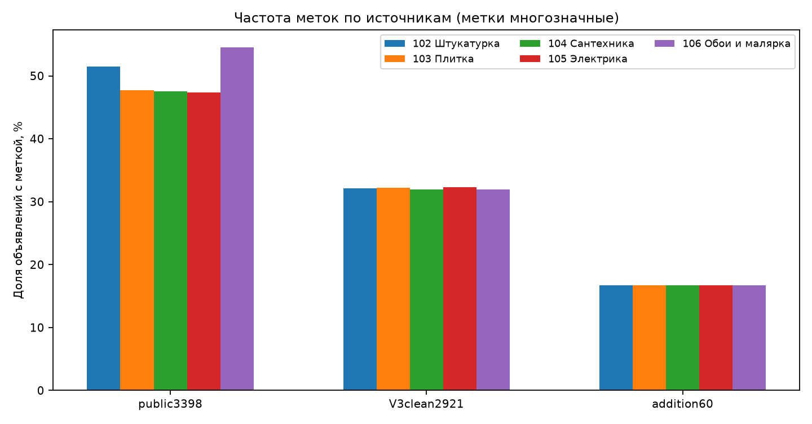
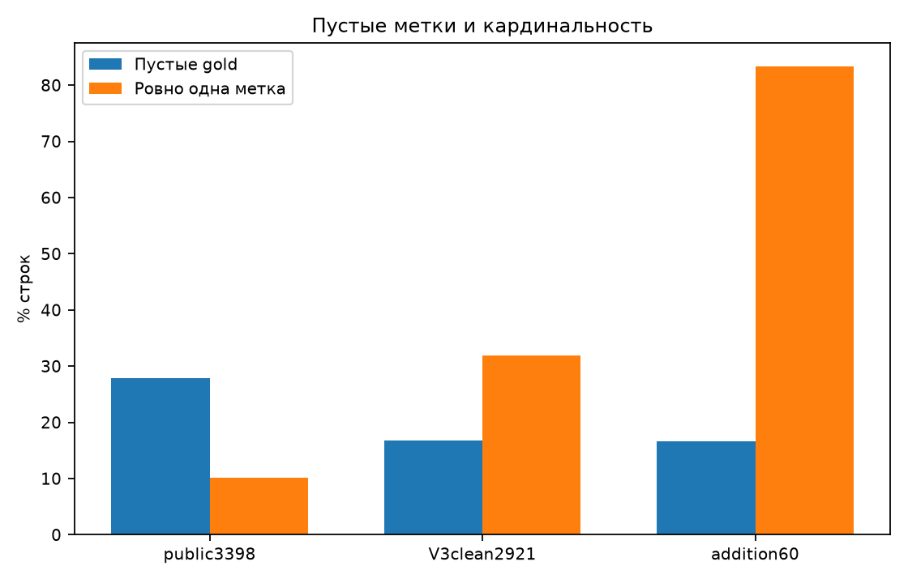
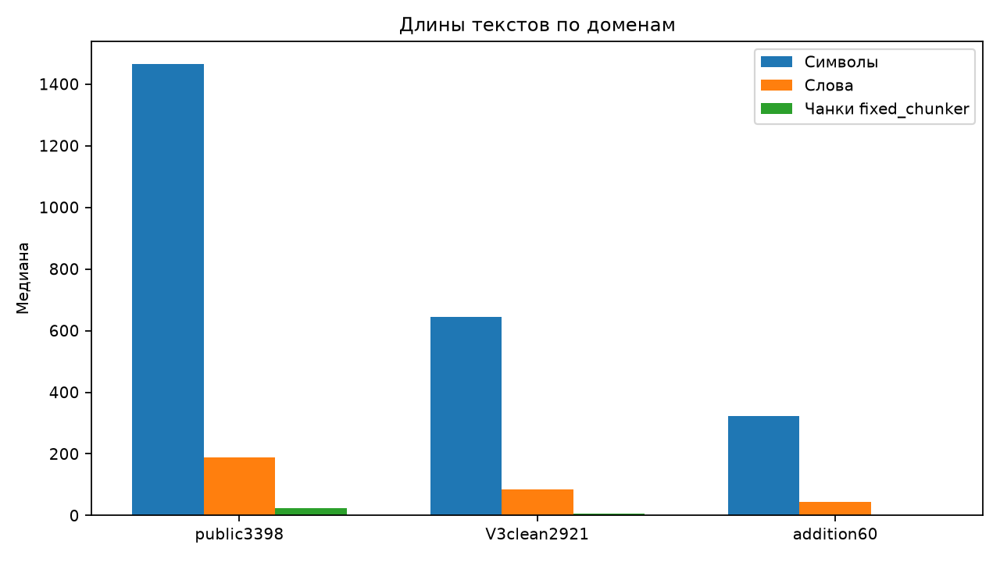

# EDA объединённого train public + V3

**Обновлённый отчёт после перепроверки gold и исходных категорий.** Gold дополнительных услуг берётся из `found_microcategories` (V3 и addition), из `labels` (public splits) или из `gold` (addition fallback); рассматриваются только ID 102–106. `offered_microcategories` отдельно сверяются с gold, но не используются как target: они могут содержать текущую исходную категорию (101–106). Для V3 source взят из реального поля `mcId`; public split не содержит этого поля, для него 101 проставлен по документированной конвенции. Official208 gold восстановлен из `categories` по названиям пяти целевых категорий.

Расчёт выполнен скриптом `eda.py` непосредственно по перечисленным в `metrics.json` входам. Parquet прочитан через DuckDB. Длины считаются по `description`, именно её подаёт существующий experiment в chunker. Hard negatives200, public_synthetic_300 и holdout20 в train не включены.

## Состав, gold и source

| Домен | Строк | Пустые additional gold | Кардинальность 0 / 1 / 2 / 3 / 4 / 5 | Частоты ID 102 / 103 / 104 / 105 / 106 |
|---|---:|---:|---|---|
| public3398 | 3 398 | 946 (27,8%) | 946 / 344 / 494 / 340 / 275 / 999 | 1 750 / 1 620 / 1 615 / 1 608 / 1 854 |
| V3clean2921 | 2 921 | 490 (16,8%) | 490 / 930 / 890 / 475 / 126 / 10 | 938 / 941 / 933 / 943 / 934 |
| addition60 | 60 | 10 (16,7%) | 10 / 50 / 0 / 0 / 0 / 0 | 10 / 10 / 10 / 10 / 10 |
| **B train** | **6 379** | **1 446 (22,7%)** | **1 446 / 1 324 / 1 384 / 815 / 401 / 1 009** | **2 698 / 2 571 / 2 558 / 2 561 / 2 798** |

Baseline без addition — 6 319 строк, 1 436 пустых gold; по кардинальности 1/2/3/4/5 — 1 274/1 384/815/401/1 009, частоты меток — 2 688/2 561/2 548/2 551/2 788. Addition меняет baseline ровно на 50 одиночных примеров (по 10 на категорию) и 10 пустых; многометочных там нет. Полные сочетания доступны в JSON.

Маргинальные частоты меток выглядят ровными, но структура по источникам иная. В public 999/3 398 записей имеют все пять меток, а 946 пусты. После правильного исключения source V3 имеет 490 пустых, 930 с одной, 890 с двумя, 475 с тремя и только 10 с пятью целевыми метками. Это отличается от `offered_microcategories`, где после отбрасывания 101 кардинальность равна 198/652/924/759/320/68. У V3 offered-поле есть во всех строках и содержит собственный source_mcId в 2 045; offered-набор, ограниченный102–106 без исключения текущего source, совпадает с найденным gold лишь в 1 213 строках. Поэтому offered нельзя трактовать как gold дополнительных услуг.

Фактическое распределение `mcId` в V3 train: 101 — 486, 102 — 484, 103 — 484, 104 — 491, 105 — 485, 106 — 491. В source-условной таблице `metrics.json` для каждой исходной категории отдельно приведены кардинальность и частота каждого target ID; у записи не бывает целевого ID, равного собственной исходной категории. По public source 101 — документированная конвенция, не извлечённое из каждой строки поле. Эта специфика не позволяет выводить перенос между неизвестными исходными категориями.

| V3 `mcId` source | Строки | Пустой gold | Частоты target 102 / 103 / 104 / 105 / 106 |
|---:|---:|---:|---|
| 101 | 486 | 60 | 199 / 188 / 188 / 183 / 176 |
| 102 | 484 | 88 | 0 / 197 / 184 / 189 / 176 |
| 103 | 484 | 84 | 182 / 0 / 187 / 183 / 188 |
| 104 | 491 | 86 | 192 / 188 / 0 / 192 / 199 |
| 105 | 485 | 89 | 176 / 183 / 178 / 0 / 195 |
| 106 | 491 | 83 | 189 / 185 / 196 / 196 / 0 |

Частоты target внутри source могут суммироваться сверх числа строк, так как gold многометочный. Кардинальность для каждой строки source и количества каждой комбинации есть в JSON.

Calibration и controls ниже приведены отдельно и не добавляются к train:

| Split | Строк | Пустые | Кардинальность 0 / 1 / 2 / 3 / 4 / 5 |
|---|---:|---:|---|
| Calibration public728 + V3 validation600 | 1 328 | 302 | 302 / 264 / 257 / 179 / 98 / 228 |
| Public validation | 729 | 203 | 203 / 71 / 95 / 82 / 65 / 213 |
| V3 test | 600 | 98 | 98 / 186 / 178 / 102 / 33 / 3 |
| Official208 | 208 | 106 | 106 / 19 / 31 / 13 / 20 / 19 |
| Addition holdout20 | 20 | 4 | 4 / 15 / 1 / 0 / 0 / 0 |

Official208 card/frequencies получены из фактических `categories`, преобразованных по именам категорий. Знакомые 13 конфликтующих групп/56 строк относятся к внутренним противоречиям official gold; это не изменяет указанные частоты по исходным строкам.

## Длины и форма входа

| Домен | Символы, медиана (P90) | Слова, медиана (P90) | Чанки fixed_chunker, медиана (P90) |
|---|---:|---:|---:|
| public3398 | 1 465 (3 435) | 189 (446) | 23 (45) |
| V3clean2921 | 644 (2 516) | 85 (319) | 6 (14) |
| addition60 | 324 (1 292) | 44 (176) | 2 (7) |

Разница длин остаётся сильной: B в основном сохраняет профиль baseline, а addition60 — очень малая и более короткая выборка. Максимумы chunk count — 121, 24 и 9 соответственно. Значит, короткое объявление с услугой в отдельном хвосте представлено иначе, чем длинное публичное описание, где целевая работа может быть глубоко в тексте.

## Дубликаты, квазиповторы и пересечения

Строгая нормализация текста для exact overlap: `casefold` и схлопывание whitespace, без удаления пунктуации. По ней все 6 379 описаний B train уникальны; точных дубликатов и конфликтных exact-групп нет. При отдельной, более агрессивной нормализации (`casefold`, замена последовательности Unicode non-word на пробел) получается 6 367 уникальных текстов: 12 строк схлопнулись, у3 групп описаний различается additional gold. Во всех3 различается также source_mcId, что объясняет разные дополнительные метки при одинаковой предлагаемой работе; это не несовместимая разметка одинакового полного входа. Идентификаторы и source сохранены в exact_conflicts.json. Такие схлопывания не являются буквальными дубликатами. По той же агрессивной нормализации unique counts: public 3 391/3 398, V3 2 916/2 921, addition60 60/60.

Для шаблонности использован тот же word TF-IDF и `compute_dup_groups`: unigram+bigrams, `min_df=2`, `max_features=30000`, sklearn default token pattern (слова из двух и более символов), default `sublinear_tf=False`, cosine ≥0,85 и connected components. Получается 5 543 компоненты, из них 224 нетривиальные, охватывают 1 060 строк; крупнейшая компонента — 189 строк. Это совпадает с группировкой проекта на B train. Число компонент — только лексическая эвристика: компоненты соединяются транзитивно и не являются единицами независимого смысла. Номинальные 6 379 строк поэтому не равны 6 379 независимым семействам, но и 5 543 нельзя интерпретировать как точное количество уникальных семейств объявлений.

Exact cross-split по строгому `casefold + whitespace`: train не пересекается с calibration, public validation, V3 test или addition holdout20. С official208 совпали 10 уникальных описаний: 10 строк train и 20 строк official. Исходный public raw — 10 000 строк, 4 855 уникальных description по строгой нормализации; все 10 000 сопоставлены с public train/calibration/validation. По пунктуационно-агрессивной нормализации raw имеет 4 841 уникальный текст. Raw используется только для provenance и не прибавляется к public3398.

Near overlap для каждого контрольного текста измерен как максимальный cosine с любым train description в train-fitted TF-IDF пространстве. Это диагностический лексический сигнал, не смысловой дубликат:

| Контроль | Строки | nearest cosine ≥0,85 | ≥0,95 | Медиана ближайшего cosine |
|---|---:|---:|---:|---:|
| Calibration | 1 328 | 193 | 157 | 0,250 |
| Public validation | 729 | 194 | 148 | 0,617 |
| V3 test | 600 | 0 | 0 | 0,160 |
| Official208 | 208 | 31 | 29 | 0,315 |
| Addition holdout20 | 20 | 0 | 0 | 0,174 |

Для public validation прежний frozen-TFIDF аудит сообщал 152/729 строк с cosine ≥0,95; этот EDA использует TF-IDF словных n-грамм, обученный только на train, и получает 148. Разница обусловлена векторизатором и не отменяет вывода о заметном лексическом сходстве public validation с train. V3 test и holdout20 имеют гораздо более низкую близость по этому измерению. Известные 13 конфликтующих description-групп official208 / 56 строк — свойство gold official, не основание автоматически считать любое расхождение ошибкой.

## Формулировки и ограничения счётчиков

Скрипт считает наличие regex-маркеров вопроса, отрицания, чужого/третьего участника, проекта/материала, SEO, продажи/каталога, чужого специалиста и услуги в хвосте. Основные маркеры:

| Строк с маркером | public3398 | V3clean2921 | addition60 |
|---|---:|---:|---:|
| Вопросительный знак | 1 148 | 300 | 6 |
| Слова отрицания/отказа | 2 275 | 2 786 | 29 |
| Слова об ином участнике/мастере | 2 361 | 1 825 | 28 |
| Проект/материал | 2 394 | 2 201 | 43 |
| Sale/catalog-маркер | 513 | 370 | 8 |
| Явный SEO-маркер | 42 | 0 | 5 |
| Regex-индикатор услуги в конце | 418 | 792 | 23 |

Это доли строк с лексическими сигналами, не разметка случаев. Слово «проект» может обозначать предлагаемую работу или только контекст; материал может продаваться, доставляться, входить в проект или просто упоминаться; отрицание может относиться к одной части сложного текста. Regex для хвоста также не проверяет, выполняет ли работу автор. Поэтому числа характеризуют потенциально релевантные формулировки и ограниченность простых детекторов.

## Содержательная выборка и перенос

Для ограниченного качественного обзора скрипт фиксирует выборку из 15 записей: по 3 с непустым gold и 2 пустых из каждого train-домена, deterministic seed 20261115. Полные тексты, gold, stratum и ID лежат в `fixed_review_sample.json`. Это качественное чтение небольшой стратифицированной выборки, не ручной аудит всей разметки и не оценка популяционных долей.

В выбранных дополнениях `tail60-train-051` — перевозка материалов, при этом отделочные работы выполняет бригада клиента; `tail60-train-060` — обмерный план с упоминаниями розеток/раковины/плитки без монтажных работ; обе записи имеют пустой gold. У V3 строка `own-v3-train-0224` демонстрирует актуальные и временные формулировки (старые предложения прекращены, на вопросы даётся прямой ответ). Эти примеры иллюстрируют границу «упоминание / действующее предложение», но не задают новые метки и не доказывают естественность всего корпуса.

Публичный домен содержит очень длинные рекламные объявления и большие пакеты работ; V3 — много искусственно построенных сочетаний действующей услуги, отрицаний, чужого участника и временного статуса. Ранее из V3 исключили 79 критичных случаев, но остальные строки не становятся реалистичными автоматически. Addition60 состоит из авторских текстов без независимой человеческой проверки. Малая выборка даёт примеры разных конструкций, а не частотную оценку реалистичности.

Прикладной риск переноса C_syntax по данным — не перекос маргинальной частоты пяти target-классов, а сочетание сильного сдвига длины/числа чанков, отличающейся структуры gold по доменам и неоднозначной связи упоминания услуги с предложением от лица исполнителя. Addition60 локально покрывает короткие описания с предложениями в конце и явные отрицательные случаи, но составляет меньше 1% B train. По этим данным нельзя утверждать, что все такие случаи трудны, задавать новые gold-метки или заключать, что нужно механически выравнивать классы.

## Артефакты и воспроизводимость

- `eda.py` — воспроизводимый data-only расчёт; запуск из корня: `/tmp/innopolis-qwen-emb-venv/bin/python output/combined-public-v3-eda/eda.py`.
- `metrics.json` — target gold, offered audit, реальные source-условные распределения, кросс-сплитные проверки и методы.
- `fixed_review_sample.json` — фиксированная выборка с полными текстами.
- `near_duplicate_examples.json`, `cross_split_near_examples.json`, `exact_conflicts.json` — текстовые пары для осмотра.
- PNG рядом с отчётом — графики частот, длин и кардинальности gold.

Скрипт не обучает классификаторы, не читает synthetic300 и не меняет датасеты, gold, пороги или модели. TF-IDF используется только для текстовой группировки/близости.
